# Helios 远程游玩（Remote Play）使用说明书

> 适用：用 Helios 把 PC 上的手柄输入，通过 **局域网 Remote Play** 发给 PS5 / PS4（无需 Titan Two、Makcu 等硬件）。
> 资料来源：Input Sense 官方文档 <https://inputsense.com/products/helios/docs/>（以下"官方文档"）。
> 账号导入 / 主机注册属于个人操作，本说明书不展开，只在流程图中占一个位置。

---

## 0. 一图看懂：整体链路

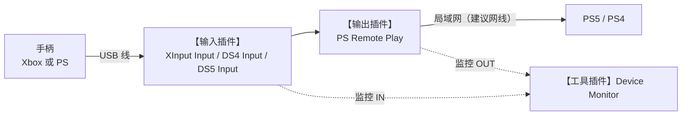

**一共要用到 3 类插件：**

| 作用 | 插件类别 | 具体插件 | 必须？ |
|---|---|---|---|
| 读手柄 | Input（输入） | Xbox 手柄 → **XInput Input**；DualShock 4 → **DS4 Input**；DualSense → **DS5 Input** | 必须，三选一 |
| 发给 PS5 | Output（输出） | **PS Remote Play** | 必须 |
| 看输入输出是否正常 | Utility（工具） | **Device Monitor** | 强烈建议 |
| 脚本/按键转换 | Scripting / Utility | GPC 3、Input Translator | 可选，纯转发不需要 |

> **不要装/不要用**：ViGEm Output、Titan Bridge、Makcu Bridge、Xbox Remote Play。它们是别的输出路线（PC 虚拟手柄 / 硬件 / Xbox 主机），与 PS5 远程无关。ViGEmBus 驱动也不需要，"按需从插件里装，不要提前装"（官方原话意思）。

---

## 1. 下载与安装

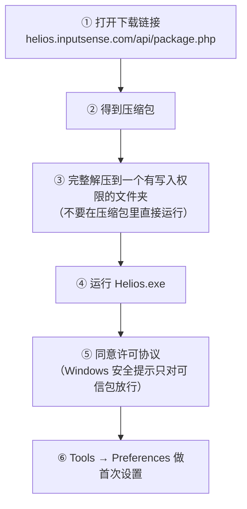

**系统要求**（官方文档）

- 64 位 Windows 10 / 11
- CPU 支持 **AVX2**
- 联网（下载、更新、登录）
- 一台能用 Remote Play 的 PS5/PS4（Pro 或普通版均可），PC 与主机同一可靠局域网

**注意事项**

- 下载入口也可从官网产品页 <https://inputsense.com/products/helios/> 的 "Download Helios" 按钮进入。
- 解压要**完整**，不要只拷贝 exe；解压路径建议用英文、非 C 盘系统目录（如 `D:\Helios\`），因为必须可写。
- 打不开：重新下载并完整解压，并确认 CPU 支持 AVX2；若杀毒软件删了文件，只从官方包还原。
- 更新：启动后自动检查；手动用 **Tools → Check for Updates**。

**首次启动 Preferences（Tools → Preferences）**

| 页签 | 远程游玩需要做什么 |
|---|---|
| Appearance | 选语言、主题、Setup（布局） |
| Hardware | 纯手柄转发可不动（Compute GPU 是视觉功能用的） |
| Python | 纯手柄转发可不动 |
| Account | 功能要求时用 Discord 或邮箱一次性链接登录 |
| Other | **Enable Developer Mode**（直通模式要开，见 §2.5） |

---

## 2. 插件在哪里？怎么加载？

插件是 `.dll` 文件，放在 **Helios 解压目录 → `versions\<版本号>\plugins`**，在软件里用 **Plugins → Load Plugin…** 加载。下面全部是实机截图。

### 2.1 主界面各区域认识

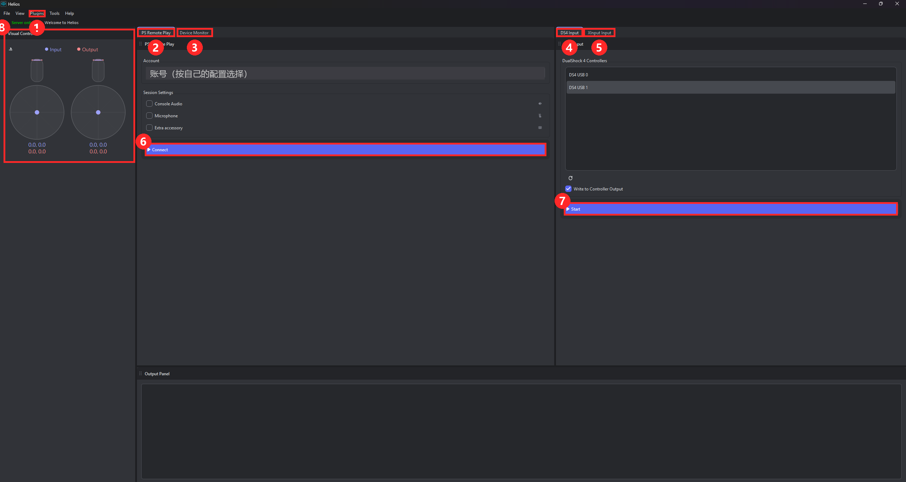

| 编号 | 位置 | 作用 |
|---|---|---|
| ① | 菜单 **Plugins** | 加载 / 卸载插件的入口 |
| ② | 标签 **PS Remote Play** | 输出插件：选账号、Connect 连接主机 |
| ③ | 标签 **Device Monitor** | 工具插件：查看 IN（输入）与 OUT（输出）数值 |
| ④ | 标签 **DS4 Input** | 输入插件：DualShock 4 手柄 |
| ⑤ | 标签 **XInput Input** | 输入插件：Xbox 手柄 |
| ⑥ | **Connect** 按钮 | 连接 PS5 |
| ⑦ | **Start** 按钮 | 启动当前输入插件 |
| ⑧ | **Visual Controller** | 可视化手柄：蓝色 Input、红色 Output，摇杆会实时移动 |

> 自己的账号选择在 PS Remote Play 的 Account 下拉框，图中已遮住，按自己的配置选择即可。

### 2.2 第一步：Plugins 菜单

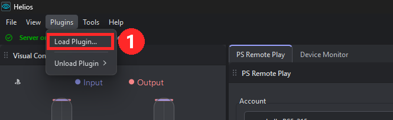

① 点 **Plugins**，有两项：**Load Plugin…**（加载）和 **Unload Plugin**（卸载，会列出已加载的插件）。

### 2.3 第二步：到 plugins 文件夹选 dll

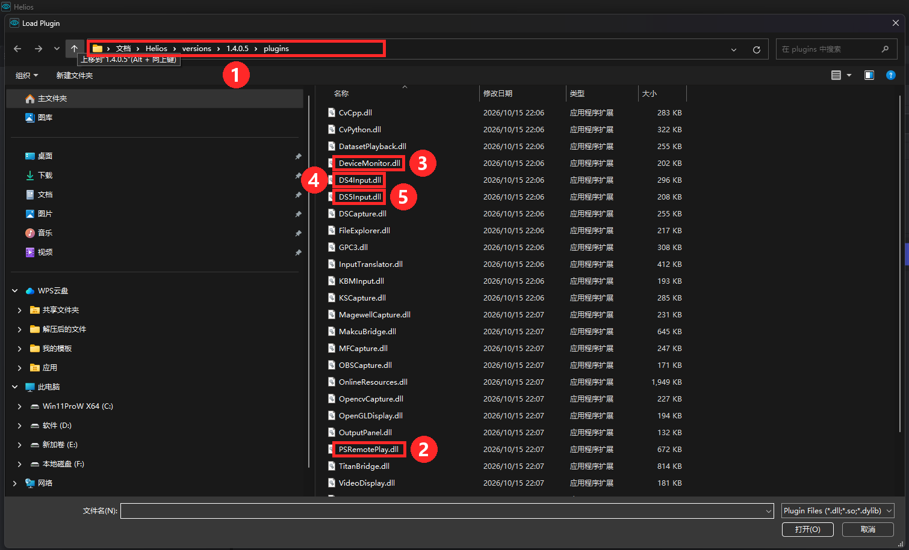

点 **Load Plugin…** 后弹出文件选择框，自动打开的就是插件目录：

① 路径：`文档 \ Helios \ versions \ 1.4.0.5 \ plugins`（版本号以你装的为准；实际是 `Helios` 解压目录下的 `versions\<版本号>\plugins`）。

需要的 dll（红框）：

| 编号 | 文件 | 用途 |
|---|---|---|
| ② | `PSRemotePlay.dll` | 输出：发给 PS5（所有手柄都要） |
| ③ | `DeviceMonitor.dll` | 监控 IN / OUT |
| ④ | `DS4Input.dll` | DualShock 4 手柄输入 |
| ⑤ | `DS5Input.dll` | DualSense 手柄输入 |
| — | `XInputInput.dll` | Xbox 手柄输入（在同一文件夹，列表更下方） |

选中 dll → 点 **打开(O)** 即加载，面板会出现在主界面。已加载过的不用重复加载；已有的组合会被保存在 Setup 里，下次启动自动出现。

> 同目录里的 `TitanBridge.dll`、`MakcuBridge.dll`、`XboxRemotePlay.dll`、`ViGEmOutput.dll`、各种 `*Capture.dll` 对 PS5 远程游玩都**用不到**，不要加载。

### 2.4 Tools 菜单

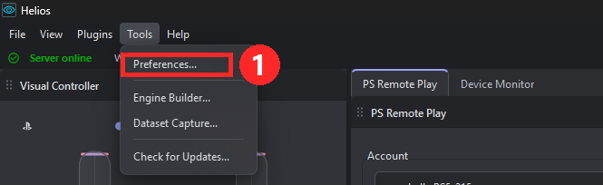

① **Tools → Preferences…** 是设置入口（Developer Mode 在这里）；**Check for Updates…** 手动检查更新。

### 2.5 Developer Mode（直通必须打开）

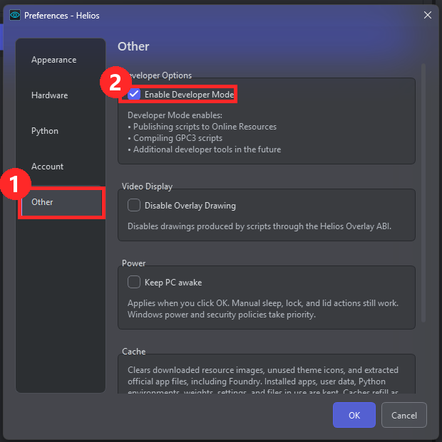

Tools → Preferences… → ① 左侧点 **Other** → ② 勾选 **Enable Developer Mode** → 点 **OK**。
不开的话，输入插件里不会出现 **Write to Controller Output**。

---

## 3. 通用操作流程（Xbox / PS 手柄都一样）

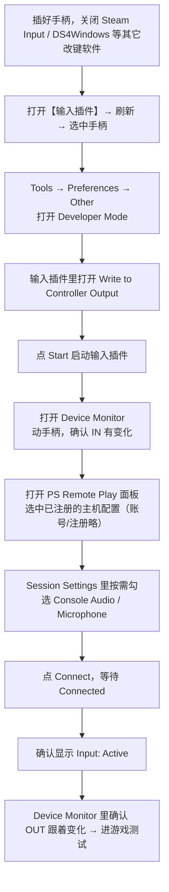

### Device Monitor 怎么看

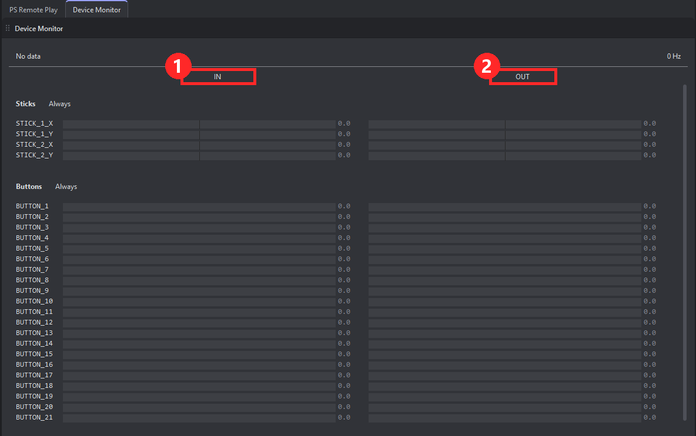

① **IN** 列：手柄实际输入　② **OUT** 列：发往 PS5 的输出。动手柄时两列的 STICK / BUTTON 数值都应变化；只有 IN 变、OUT 不变，见 §7。

要点：

1. **启动顺序：先启动输入，再启动输出**（官方原话）。
2. "直通"= 手柄原样转发。需要 **Developer Mode** + 输入插件的 **Write to Controller Output**。
3. 若以后改用 GPC 3 脚本处理输出，必须**关掉** Write to Controller Output，否则输出会重复。
4. 同一时间只用**一个**输出路径。

---

## 4. Xbox 手柄

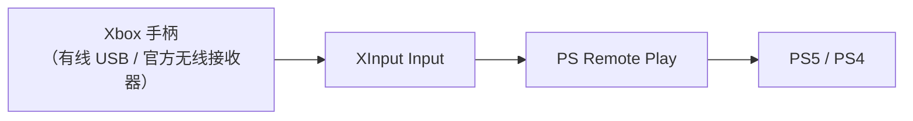

| 项目 | 内容 |
|---|---|
| 输入插件 | **XInput Input** |
| 支持设备 | Xbox 手柄及其它走 Windows XInput 的手柄（官方未列具体型号） |
| 手柄槽位 | 在插件里选 Controller slot。多个槽位时，推动摇杆同时看 Device Monitor 判断哪个是真实手柄；Helios 会优先恢复上次槽位，否则选第一个已连接手柄 |
| 轮询率 | 可选 125 / 250 / 500 / 1000 Hz；**建议先用 250 Hz**，高轮询不稳定就退回 250 |
| 特殊键 | Guide 键 → `BUTTON_1`；Share 键 → `BUTTON_18`（Share 依赖 Windows GameInput，不支持时其余按键仍正常） |

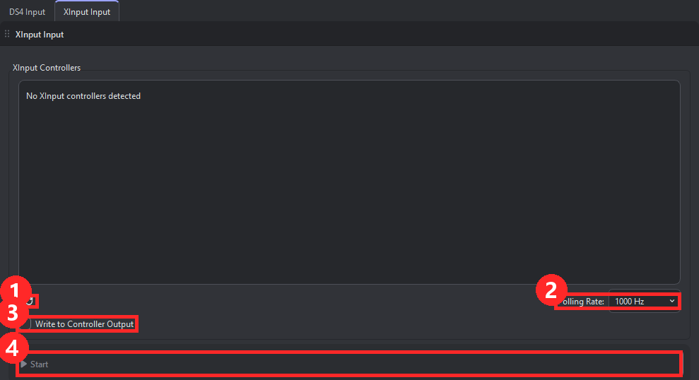

① 刷新按钮（手柄列表空时点它）　② Polling Rate 轮询率　③ Write to Controller Output（需 Developer Mode）　④ Start

**步骤**

1. 连接手柄 → XInput Input 面板点刷新 → 选对槽位。
2. 轮询率先设 250 Hz。
3. 打开 Developer Mode 和 Write to Controller Output，点 Start。
4. Device Monitor 验证 IN → 连接 PS Remote Play → 验证 OUT。

**常见问题**

- 列表里没有手柄：重新插拔，关闭其它改键软件。
- 高轮询率下卡顿/不稳：降回 250 Hz。
- 输入重复：说明有虚拟手柄回灌到输入，停掉多余的输入/改键工具。

---

## 5. PS 手柄（DualShock 4 / DualSense）

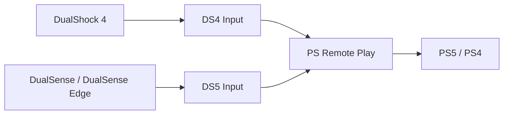

| 项目 | DualShock 4 | DualSense（PS5 手柄） |
|---|---|---|
| 输入插件 | **DS4 Input** | **DS5 Input** |
| 连接方式 | USB 或蓝牙；蓝牙不稳/延迟高就换 USB | **建议 USB**（连接最稳定、上报最完整）；官方未提蓝牙支持 |
| 轮询率选项 | 无，按手柄自身上报速率读取 | 官方页面未提供选项 |
| 额外按键 | — | 支持 DualSense Edge 的背键（Paddle） |
| 必须关闭的软件 | DS4Windows、Steam Input 等 | Steam Input 等 |

DS4 Input / DS5 Input 的面板与主界面 ④ 相同：上方是手柄列表（如 `DS4 USB 0`），下方是刷新按钮、**Write to Controller Output** 和 **Start**；它们没有 Polling Rate 选项。

**步骤**

1. 用 USB 连接手柄。
2. 打开对应输入插件（DS4 Input 或 DS5 Input）→ 刷新 → 选中手柄。
3. 打开 Developer Mode 和 Write to Controller Output，点 Start。
4. Device Monitor 里检查按键、摇杆、扳机（Edge 还要查背键）。
5. 连接 PS Remote Play，确认 OUT 正常。

**常见问题**

- 设备不显示：关闭 Steam Input / DS4Windows 等会"抢占或隐藏"手柄的软件。
- 断开重连后没反应：等面板自动重连，或刷新后重新选择。
- 手柄在 Windows 里正常但 Helios 里没有：拔掉 → 关闭竞争软件 → 重新插入 → 刷新。

---

## 6. 两种手柄对比速查

| | Xbox 手柄 | DualShock 4 | DualSense |
|---|---|---|---|
| 输入插件 | XInput Input | DS4 Input | DS5 Input |
| 输出插件（都一样） | PS Remote Play | PS Remote Play | PS Remote Play |
| 连接 | USB / 接收器 | USB / 蓝牙 | 建议 USB |
| 轮询率可调 | 是（125–1000 Hz） | 否 | 否（官方未提） |
| 额外设置 | 选槽位 | — | — |
| 易冲突软件 | 其它 XInput 改键 | DS4Windows、Steam Input | Steam Input |

---

## 7. 故障排查速查表

| 现象 | 处理 |
|---|---|
| Device Monitor 没有 IN | 刷新并重新选择手柄，重启输入插件 |
| IN 有变化，OUT 没变化 | 直通模式：确认 Developer Mode 与 Write to Controller Output 已开；脚本模式：确认 GPC 3 在运行 |
| OUT 有变化，主机没反应 | 检查 PS Remote Play 是否 Connected、是否显示 Input: Active |
| 发现主机失败 | 唤醒主机，手动输入主机局域网 IP |
| 注册失败 | 在主机上重新生成 8 位 PIN，并确认主机类型与账号 |
| 连接被倒计时挡住 | 等倒计时结束再重试 |
| 画面/连接不稳定 | 用有线网络，或改善 Wi-Fi |
| 按键重复 | 关闭其它改键软件；确认游戏只使用目标设备 |
| 某些游戏无反应 | 官方提示：部分游戏可能限制或阻止 Remote Play |
| 配置丢失 | Helios 会自动重建损坏的存储；若被删，需重新注册主机 |

---

## 8. 与本仓库的关系

本目录的 *PS5 Input Bridge* 是另一个独立工具（基于 chiaki-ng），与 Helios 无关；本说明书只涉及 Helios。
